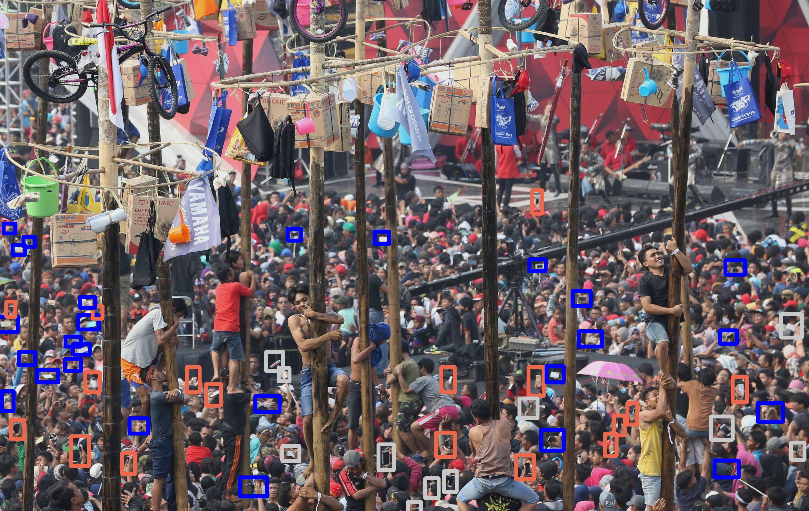
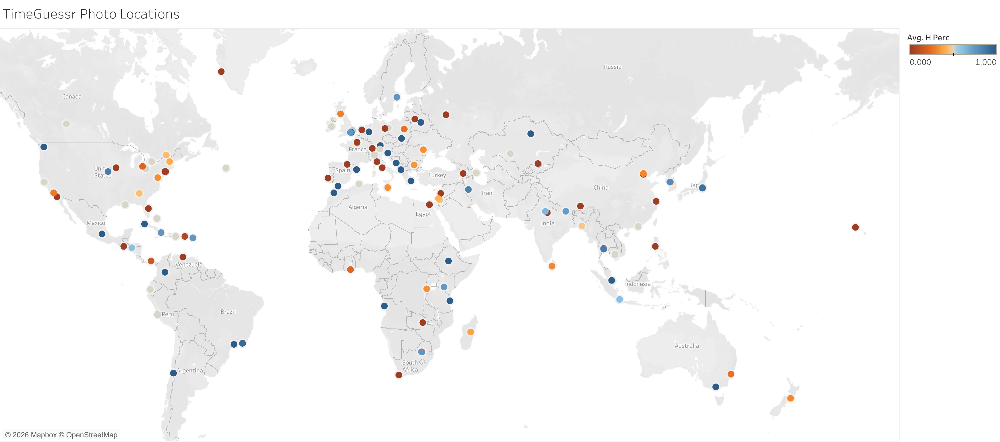
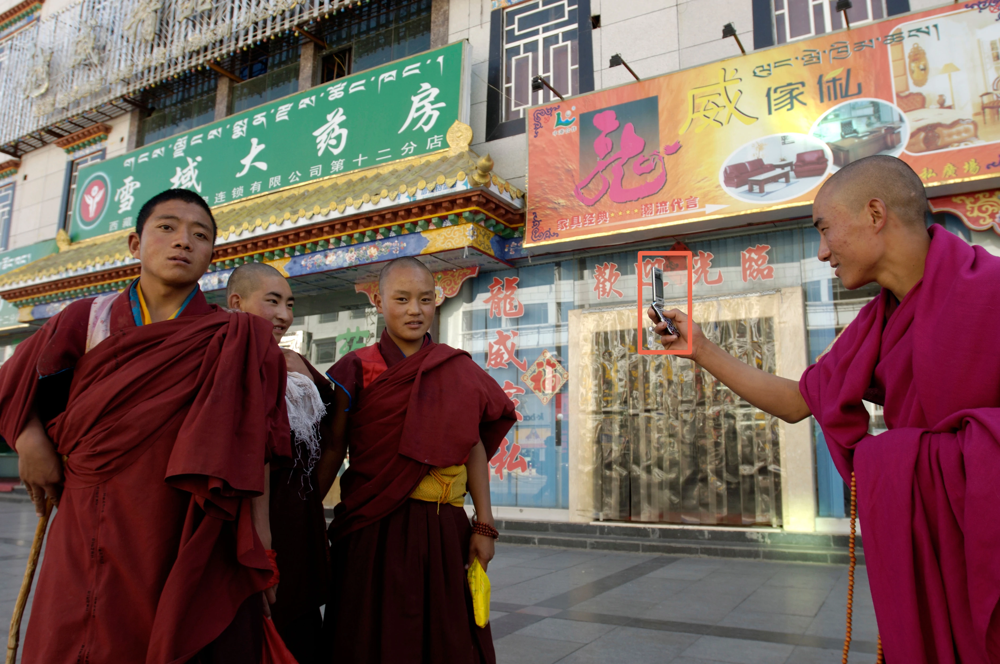
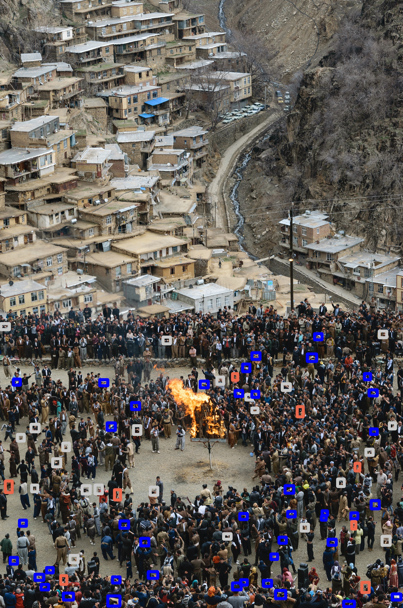
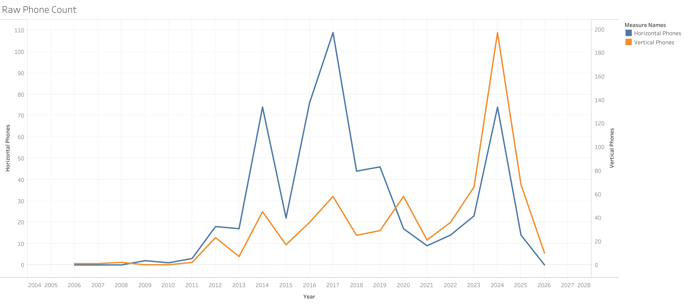
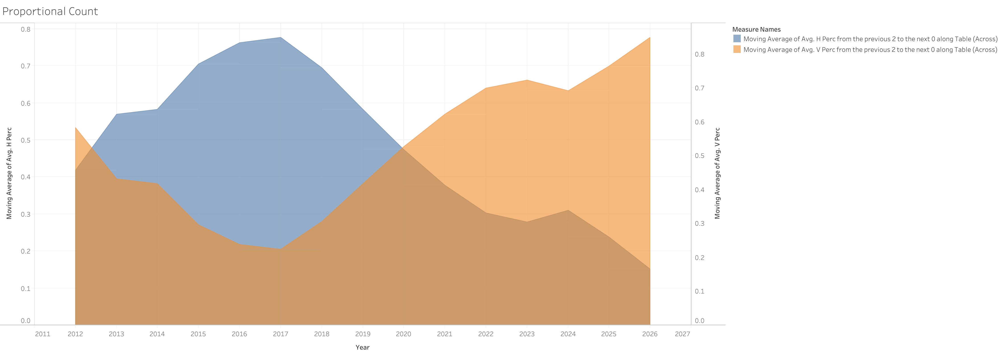
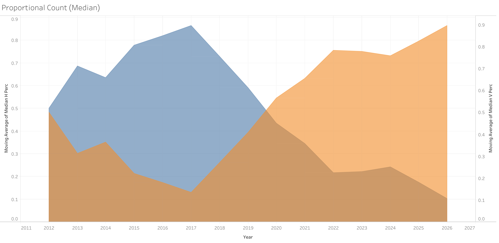
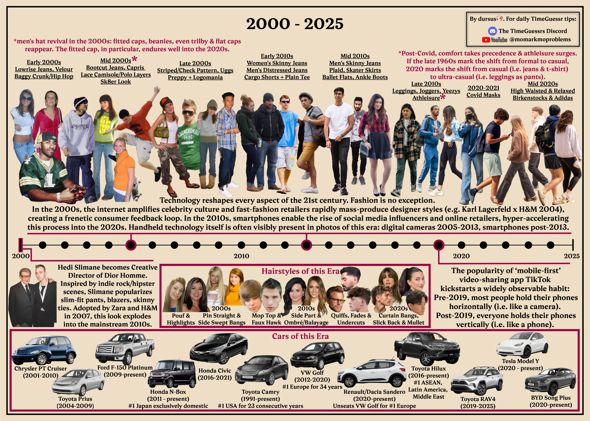

# Landscape to Portrait Orientation Shift: A TimeGuessr Analysis (2012–2026)

> *This analysis includes 151 manually-cataloged TimeGuessr images, Exploratory Data Analysis in Tableau, and a chi-square test to empirically prove when the world switched from filming horizontally to filming vertically. This is the introduction to a much larger data story about the global shift from desktop to mobile.*

## Project Overview
TimeGuessr is an online game where you look at historical photographs and try to pinpoint both the exact year and the geographic location on a map where each photo was taken.

I'm a huge fan of the game. Over the course of 3+ years of daily play, I built intuitions about countless trends and patterns in culture, fashion, technology and how those artifacts show up in everyday photographs.

This analysis focuses on one of those intuitions I shared with the TimeGuessr community as a tip:

> [!TIP]
> In the 2010s, the dominant phone orientation when taking a picture is horizontal (i.e, landscape mode). In the 2020s, this reverses and the dominant phone orientation when taking a picture is vertical (i.e., portrait mode).

When I shared this insight back in April 2026, it was just an intuition without proof. This project finally turns that intuition into **statistical proof**. I sampled 151 random Timeguessr photos from 78 different countries and territories over a 20-year timespan, annotated 1,525 people with bounding-boxes, and can now confidently cite real data to substantiate those intuitions.

---

## Key Findings & Insights
* **The 2019/2020 Crossover:** The graph of the raw count and the proportional count show a clear crossover point around **2019–2020**, where vertical phone orientation officially overtook horizontal orientation.
* **Global Consistency:** This shift is culturally independent and observable in major metropolitan areas around the world: Asia, Africa, Europe, North America, South America, and Oceania.
* **Subject-Independent:** Phone orientation is largely independent of the subject of the photograph. The most common subject of many TimeGuessr photographs in both the 2010s and 2020s is a parade, festival, or procession, yet the correlation between year and orientation persist. In certain photographs, there is a clear disconnect between the phone orientation and the subject of the photograph (i.e., horizontal filming of a vertical activity or vertical filming of a horizontal activity).

 
_IMG_050 (Jakarta, Indonesia) uniquely highlights subject-independence: Despite filming a vertical activity, the dominant phone orientation is horizontal, which strongly correlates with the year (2017) and not the subject of the photograph._

---

## Methodology

1. **Data Collection:**

Custom `phone_orientation_dataset.csv` built in Google Sheets. 151 images were sourced using the 'random mode' in Timeguessr (which pulls from the entire TimeGuessr daily archive containing 6,000 photographs) as well as sourced from all daily game rounds in 2026 (archived and catalogued by daily TimeGuessr players on YouTube and Twitch).

 
_Each dot on the map represents an image that was catalogued and annotated in the dataset._

   * Built a custom **Python/OpenCV script** (`annotate_photos.py`) to manually catalog and draw color-coded bounding-boxes on devices:
     * 🔵 **Blue:** Horizontal / Landscape
     * 🟠 **Coral:** Vertical / Portrait
     * ⚪ **White:** Ambiguous / Traditional Digital Cameras
* Criteria for marking 🔵 Blue or 🟠 Coral:
     * **The device must be visible and must be a phone.** If the image was too blurry, or hands obscured the device, or I could not tell if it was a phone or digital camera, it was marked with a white bounding-box.
     * **The person must be in the act of taking a picture.** There are clear indicators someone is taking a picture: the phone is raised over the head, or there's a two-handed grip framing the phone, or the phone lens is angled towards a clear subject. If it was unclear whether a person was taking a picture or simply looking at their phone screen, it was marked with a white bounding-box.
     * **The phone must be oriented in a clear direction.** If a person's phone was angled at 45° or in the middle of orienting motion, then it was not counted and marked with a white bounding-box.

Only 🔵 Blue and 🟠 Coral marked phones were used in the calculations, graphs, and statistical analysis. 

2. **Data Cleaning:**
  * *Pre-2012 Photographs:* Prior to 2012, the dominant picture-taking device is not a phone but a digital camera. Although I found some valid TimeGuessr photographs from 2006 to 2012, there were too few photos, often with only one person and one phone representing the entire year. This created skewed outliers for those years, so the analysis was narrowed to post-2012, the year phones started to surpass digital cameras and became the dominant picture-taking device.

 
_IMG_134 (Lhasa, Tibet, China) is the earliest dated photograph (2006) in the dataset._

3. **Data Analysis:**
   * *The Electoral College Problem:* Each year contains a wide range of photographs. Some have one or two phones while others have 30+. How do you balance giving each country and location equal weight to truly capture the global big picture trend when each photograph has a different population/number of people?

 
_IMG_037 (Sanandaj, Iran) contains 41 horizontal and 8 vertical phones. This single location could drown out the other 2017 photographs if we used a raw total count alone._

 
_Raw phone count shows horizontal count consistently above vertical through the 2010s and the reverse during the 2020s. However, the total counts for each year are skewed by years with large crowds._

To correct the effect of large crowds, I normalized each photograph by assigning each a proportional calculation (e.g., 41 horizontal and 8 vertical calculates to a score of 0.84 for horizontal and 0.16 for vertical) and then averaging photograph proportion grouped by each year and using Tableau's moving average to smooth the line graph.

 
_Proportional count graph with average (mean) for each year._

However, this creates the classic Electoral College problem where a picture with 2 people carries as much weight as a picture with 40. Unlike the tricky problem of representational politics, this problem had a simple solution: find the central value least affected by either outlier, i.e., the median.

 
_Proportional count graph using median instead of mean._

There is a clear crossover point around 2019/2020. That inflection point is significant because 2019 marks the mainstream popularity of TikTok and the widespread adoption of vertical-scrolling, mobile-first, photo and video sharing platforms. That exact year tied back to the infographic I shared with the TimeGuessr community back in April 2026.

 
_Infographic shared with TimeGuessr community April 2026. In it, I highlighted my observations about the rise of TikTok and vertical video platform in 2019 and its observable effect on photo-taking habits around the world._

I ran a chi-square analysis to find the statistical difference between horizontal and vertical phones, pre/post-2019.

| Era | Horizontal Phones | Vertical Phones | **Row Total** |
| :--- | :---: | :---: | :---: |
| **Pre-2019 (2012–2019)** | 406 | 240 | **646** |
| **Post-2019 (2020–2026)** | 151 | 456 | **607** |
| **Column Total** | **557** | **696** | **Grand Total ($N=1253$)** |

Expected frequency formula:

$$E = \frac{(\text{Row Total}) \times (\text{Column Total})}{\text{Grand Total}}$$

* **Pre-2019 Horizontal Expected ($E_{11}$):** $\frac{(\text{Total Pre}) \times (\text{Total Horizontal})}{\text{Grand Total}} = 287.168$
* **Pre-2019 Vertical Expected ($E_{12}$):** $\frac{(\text{Total Pre}) \times (\text{Total Vertical})}{\text{Grand Total}} = 358.832$
* **Post-2019 Horizontal Expected ($E_{21}$):** $\frac{(\text{Total Post}) \times (\text{Total Horizontal})}{\text{Grand Total}} = 269.832$
* **Post-2019 Vertical Expected ($E_{22}$):** $\frac{(\text{Total Post}) \times (\text{Total Vertical})}{\text{Grand Total}} = 337.168$

$$
\chi^2 = \sum \frac{(O_i - E_i)^2}{E_i}
$$

* **Pre-2019 Horizontal Chi-Square Stat ($\chi^2_{11}$):** $\frac{(406-287.168)^2}{287.168} = 49.173$
* **Pre-2019 Vertical Chi-Square Stat ($\chi^2_{12}$):** $\frac{(240-358.832)^2}{358.832} = 39.353$
* **Post-2019 Horizontal Chi-Square Stat ($\chi^2_{21}$):** $\frac{(151-269.832)^2}{269.832} = 52.333$
* **Post-2019 Vertical Chi-Square Stat ($\chi^2_{22}$):** $\frac{(456-337.168)^2}{337.168} = 41.881$

$$
\chi^2 = 182.74
$$

Degrees of Freedom ($df = 1$) | $\alpha = 0.05$ | Critical Threshold = 3.841 | $p<0.0001$

---

## Conclusions & Future Developments

With a chi-square value of 182.74 and a $p$ value < 0.0001, we can conclude that the association between the year and the phone orientation is **extremely statistically significant**. This is also clearly visualized in the Tableau graphs above.

The conclusions of this report serve as Part I of a much larger data story about "How Mobile Won the Battle of the Screens." My next steps are to analyze another concurrent shift during 2012-2026: YouTube to TikTok, the structured horizontal grid to the infinite vertical scroll, the shift from desktop-first mentality to mobile-first mentality. 

It was also satisfying to develop a more statistically rigorous method of finding trends in TimeGuessr. Although, a clear downside is that marking 151 photos takes a long time to do manually. As part of a longer-term project, I'd like to learn how to automate the photo collection process, annotation, counting, and statistical analysis to expand this for various other trends (e.g., Merry Widow hat of 1907-1914, disappearance of men's facial hair post-WWI and its reappearance in the late 1960s, adoption rate of skinny jeans among men vs women in the 2010s). I will save this for a future date.

---

## Files

* **`phone_orientation_dataset.csv`**: Contains the cleaned 151 photograph dataset with years, locations, latitude, longitude, counts, photo description, and source.
* **`annotate_photos.py`**: Interactive OpenCV annotation tool used to manually process image assets.
* **`annotated/`**: High-resolution previews and bounding-box markups of all 151 photographs.
* **`readme_png_refs/`**: Tableau results map and graphs.

---
## Author
Created by **David Boucard**. Feel free to reach out or connect on [LinkedIn](https://www.linkedin.com/in/david-boucard-19318246/)!
