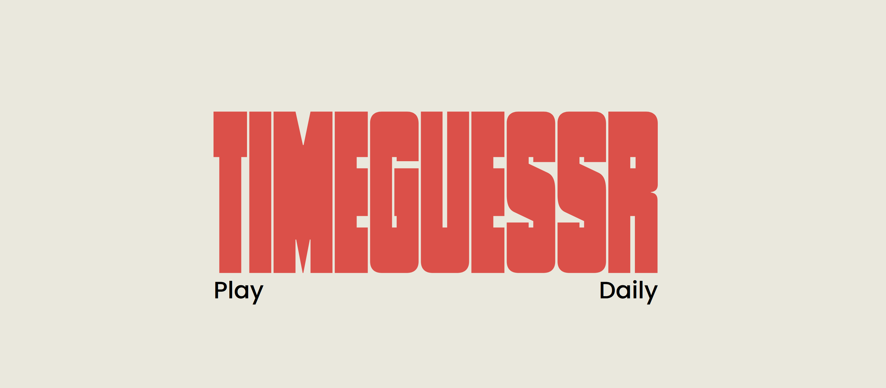

# Landscape to Portrait Orientation Shift: A TimeGuessr Analysis (2012–2026)

> *Using 151 manually cataloged TimeGuessr images and a chi-square test to empirically prove when the world switched from filming horizontally to filming vertically.*

## Project Overview
TimeGuessr is an online game where you look at historical photographs and try to pinpoint both the exact year and the geographic location on a map where each photo was taken.

I'm a huge fan of the game. Over the course of 3+ years of daily play, I built intuitions about countless trends and patterns in culture, fashion, technology and how those artifacts show up in everyday photographs.

This analysis focuses on one of those intuitions:

> [!TIP]
> In the 2010s, the dominant phone orientation when taking a picture is horizontal. In the 2020s, this reverses and the dominant phone orientation is vertical.

When I shared this insight with the TimeGuessr community back in April 2026, it was just an intuition without proof. This project finally turns that observation into a **statistically-validated data story**. By sampling 151 random Timeguessr photos from 78 different countries and territories over a 20-year timespan, then bounding-box annotating 1,525 people, I can now cite real data to back up my intuitions.

---

## Key Findings & Insights
* **The 2019/2020 Crossover:** The graph of the raw count and the proportional count show a clear crossover around **2019–2020**, where vertical phone orientation officially overtook horizontal orientation.
* **Global Consistency:** This shift is culturally independent and observable in major metropolitan areas around the world: North America, Europe, Asia, Africa, and South America.
* **Subject Independent:** Phone orientation is largely independent of the subject of the photograph. The most common subject of many TimeGuessr photographs in both the 2010s and 2020s is a parade, festival, or procession, yet the correlation between year and orientation persist. In certain highlighted cases (IMG_050), the orientation strongly correlates with the year and not the subject of the photograph. 

---

## Methodology

1. **Data Collection:**
I built a custom dataset in Google Sheets. The 151 images were sourced from the 'random mode' in Timeguessr as well as games archived and catalogued by daily TimeGuessr players on YouTube and Twitch.
   * Built a custom **Python/OpenCV script** (`annotate_photos.py`) to manually catalog and draw color-coded bounding boxes on devices:
     * 🔵 **Blue:** Horizontal / Landscape (Desktop era)
     * 🟠 **Coral:** Vertical / Portrait (Mobile-first era)
     * ⚪ **White:** Ambiguous / Traditional Cameras
2. **Data Cleaning:**
   * *The Electoral College Problem:* Raw averages were easily skewed by single-person photos (100% horizontal) versus massive stadium crowds.
   * *The Solution:* Switched from arithmetic means to the **median of proportions per year** to establish a robust central tendency completely immune to outlier distortion.
3. **Data Analysis:**
   * **Tableau:** Built an interactive dashboard featuring a global symbol map synced with normalized yearly trend lines and custom visual image tooltips.

---

## Results

---

## Files

* **`Phone Orientation Dataset - Photos.csv`**: Contains the cleaned 151 photograph dataset with years, locations, latitude, longitude, counts, photo description, and source.
* **`annotate_photos.py`**: Interactive OpenCV annotation tool used to manually process image assets.
* **`annotated/`**: High-resolution previews and bounding-box markups of all 151 photographs.
* **`readme_png_refs/`**: Tableau results map and graphs.

